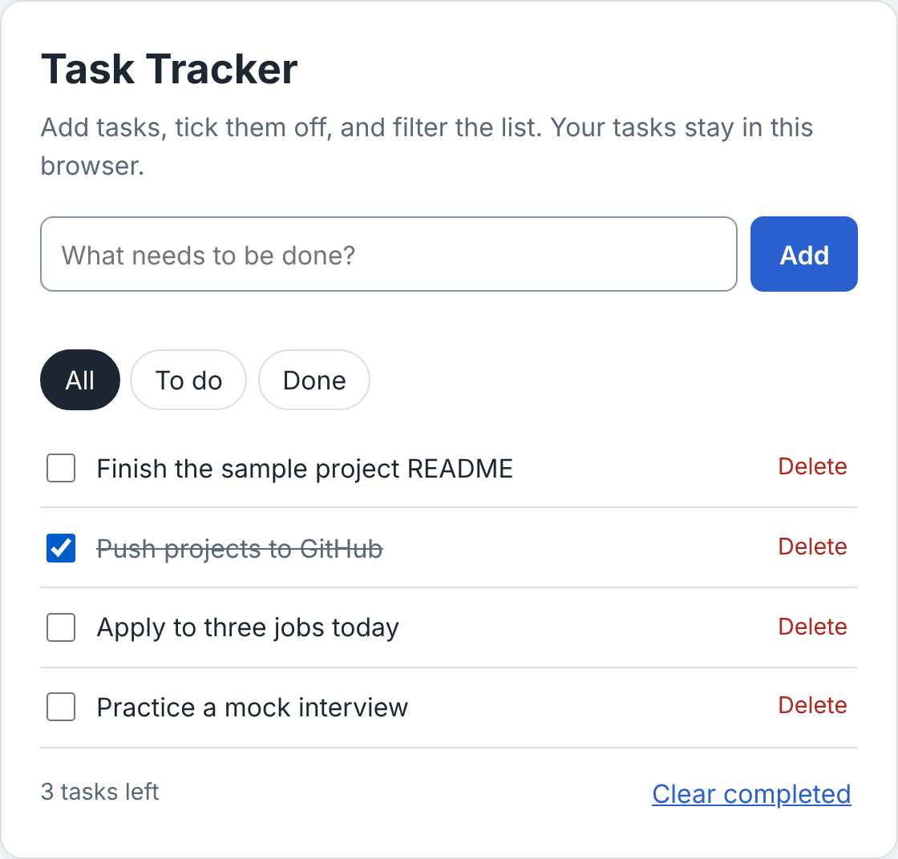

# Task Tracker

A small to-do app written in plain HTML, CSS, and JavaScript. No frameworks or libraries. It is a portfolio project for practicing DOM handling, events, and saving data in the browser.

## What it does

- Add a task with the form (up to 120 characters). Empty and duplicate tasks are rejected with a clear message.
- Tick a task as done, or delete it.
- Filter the list by All, To do, or Done.
- Shows how many tasks are left and clears all completed tasks in one click.
- Keeps your tasks in the browser using `localStorage`, so they survive a reload.

## Run it

Open `index.html` in a browser. There is no build step.

## How it works

- `app.js` keeps the list in one array of `{ id, text, done }` objects, saves it after every change, and redraws the list from that array.
- Task text is written with `textContent`, so anything a user types is shown as text and never run as HTML.
- A single click listener and a single change listener on the list handle every delete button and checkbox (event delegation).
- Reading and writing `localStorage` is wrapped in `try/catch`, so the app still works if storage is blocked.
- Keyboard and screen reader basics: a hidden label on the input, `aria-pressed` on the filter buttons, a polite live region for the task count, and visible focus outlines.

## Checks I ran

- Adding, completing, filtering, deleting, and clearing tasks behave as described.
- Tasks are still there after a page reload.
- Entering `<b>bold</b>` shows the literal text instead of bold text.

## How this was made

This is a portfolio sample. It was built by Jhon Michael Tamayo with help from an AI assistant (Claude) and tested in a browser.
